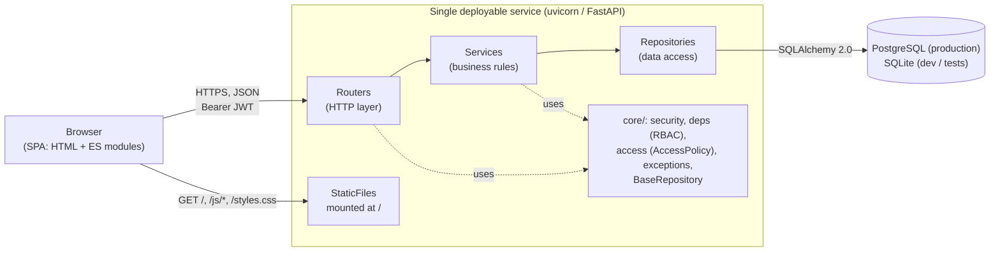

# RentalHQ — Design & Testing Document

| | |
|---|---|
| **System** | RentalHQ: rental property management system (REST API + web frontend) |
| **Repository** | https://github.com/Oloche-Emmanuel/project_zero |
| **Live deployment** | https://rentalapp-h59x.onrender.com (Render, Oregon region) |
| **Document date** | 10 October 2026 |
| **Code version** | `main`, security-fix release of 10 Oct 2026 (first reviewed at `536c4fb`) |

This document has two parts:

- **Part A — Design & Architecture**: the technologies chosen, the architectural style, the design patterns used and the reasons for each, plus recommended deployment options and their cost implications.
- **Part B — Software Testing**: every test carried out, both automated and manual, why each was chosen, the results, and the defects found.

---

# Part A — Design & Architecture

## A1. System overview

RentalHQ lets landlords and administrators manage **properties, units, tenants, leases, rent invoices/payments and maintenance requests**. Tenants can log in and raise maintenance requests. Three roles exist: `admin`, `landlord` and `tenant`.

The system is one deployable service. A Python/FastAPI backend exposes a versioned JSON REST API under `/api/v1/...`. The same process also serves a static single-page web frontend from `/`.



## A2. Technology choices

| Concern | Choice | Why it was chosen | Alternatives considered |
|---|---|---|---|
| Language | **Python 3.11+** (deployed on 3.12) | Readable and fast to develop in. Strong ecosystem for web APIs and data access. Easy to hire for and to teach. | Node.js/TypeScript, Java/Spring, C#/.NET: all viable but heavier to set up for a small team. |
| Web framework | **FastAPI** | Validates requests and responses from type hints. Generates **OpenAPI/Swagger docs automatically** (`/docs`). Has a built-in **dependency injection** system, used here for DB sessions, authentication and role checks. Also high performance (ASGI). | Flask (needs extensions for validation and docs), Django REST Framework (more batteries but more weight and convention than needed). |
| ASGI server | **uvicorn** | The standard production server for FastAPI. Light and fast. | Gunicorn with uvicorn workers (recommended once more than one worker is needed). |
| ORM | **SQLAlchemy 2.0** (typed `Mapped[...]` models) | Mature and database-agnostic. Typed models catch errors early. The same code runs on SQLite and PostgreSQL, so switching databases is a configuration change. | Django ORM (tied to Django), raw SQL (more code, less portable). |
| Validation / schemas | **Pydantic v2** | Integrated with FastAPI. Separates the API contract (`schemas.py`) from the database model (`models.py`), so internal fields such as `hashed_password` are never serialised to clients. | Marshmallow. |
| Configuration | **pydantic-settings** | All configuration comes from environment variables or `.env` through one typed `Settings` object (`config.py`). This follows the 12-factor approach: the same build runs locally and in the cloud with different environment values. | Reading `os.environ` directly (untyped, scattered). |
| Database (dev/test) | **SQLite** | No setup needed: a single file, or in-memory for tests. Ideal for local development and fast automated tests. | — |
| Database (production) | **PostgreSQL 17** | A robust relational database with real concurrency, enforced foreign keys and managed hosting on every major cloud. Rental data (leases, invoices, payments) is highly relational and needs ACID transactions. | MySQL (equally viable), MongoDB (a poor fit for strongly relational, transactional data). |
| Schema migrations | **Alembic** | The standard migration tool for SQLAlchemy. Supports versioned, reviewable schema changes. The app applies pending migrations automatically at startup (`rentalapp/migrate.py`), so every environment is always on the latest schema without a manual step. | `create_all()` alone (cannot alter existing tables). |
| Authentication | **JWT bearer tokens** (python-jose, HS256) | Stateless: the server keeps no session store, so it scales horizontally without sticky sessions. Matches the OAuth2 password flow that FastAPI documents natively. | Server-side sessions with cookies (needs CSRF protection and a session store). |
| Password hashing | **bcrypt** | A deliberately slow, salted, industry-standard algorithm that resists brute-force attacks. The code truncates input to bcrypt's 72-byte limit explicitly, so behaviour is predictable. The work factor is configurable (`BCRYPT_ROUNDS`, default 12): production keeps the default and the test suite lowers it for speed. | Argon2 (also excellent), SHA-256 (not suitable for passwords). |
| Frontend | **Vanilla JavaScript (ES modules), HTML, CSS** with no build step | Nothing to compile and no `node_modules`. FastAPI serves it directly, so there is **one artefact to deploy**. It was enough for a CRUD-style admin interface. | React/Vue (better for large interactive UIs, but adds a build pipeline and a second deployable). |
| Testing | **pytest**, **pytest-cov**, FastAPI **TestClient** (httpx) | pytest is the standard Python test runner. TestClient exercises the full HTTP stack in-process without a running server. pytest-cov measures coverage. | unittest (more boilerplate). |
| Source control | **Git + GitHub** | Version history, collaboration and integration with the hosting platform (Render auto-deploys on push to `main`). | — |
| Hosting | **Render** (web service + managed PostgreSQL) | Git-push deployment, managed TLS, managed Postgres and a free tier for demonstration. See §A6. | AWS, Azure, on-premises (compared in §A6). |

## A3. Architectural style: modular monolith with layered modules

### A3.1 Modular monolith

The backend is **one deployable application** (a monolith), but its code is split into **self-contained feature modules** under `src/rentalapp/modules/`:

```
src/rentalapp/
├── main.py          App factory: registers routers, error handler, static frontend
├── config.py        Typed settings from environment
├── database.py      Engine, session factory, declarative Base, get_db()
├── core/            Cross-cutting concerns shared by all modules
│   ├── security.py    Password hashing, JWT encode/decode
│   ├── deps.py        get_current_user, get_optional_user, require_roles(...)  (RBAC)
│   ├── access.py      AccessPolicy: who may see/change which record (ownership)
│   ├── exceptions.py  Domain error hierarchy → HTTP status codes
│   └── repository.py  Generic BaseRepository[Model] (CRUD)
├── migrate.py       Applies Alembic migrations at startup
├── create_admin.py  CLI to create/promote the first admin account
└── modules/
    ├── users/  properties/  tenants/  leases/  payments/  maintenance/
    │     each contains: models.py  schemas.py  repository.py  service.py  router.py
```

**Why a modular monolith rather than microservices?**

- **Right-sized for the problem and the team.** Microservices add network calls, distributed transactions, service discovery and several deployments. None of that pays off for a small team with a single relational data model.
- **Transactional consistency.** Business rules span entities. For example, creating a lease must also mark the unit occupied. In a single process with one database, that is a plain database transaction. Across services it would need sagas or eventual consistency.
- **Cheaper to run.** One service and one database. This matters for the cost analysis in §A6.
- **A path to services later.** Each module owns its own models, repository, service and router. If one area later needs to scale independently (for example, payments), it can be extracted along an existing boundary without a rewrite.

### A3.2 Layered architecture inside each module

Each module is a **vertical slice** with three layers and a strict call direction:

| Layer | File | Responsibility | Must not |
|---|---|---|---|
| Presentation / HTTP | `router.py` | Routes, status codes, auth dependencies, request/response schemas | Contain business rules or SQL |
| Business logic | `service.py` | Domain rules: no double-booked units, lease date validation, invoice status transitions, ownership checks | Know about HTTP |
| Data access | `repository.py` | Database queries | Contain business decisions |
| Domain model | `models.py` / `schemas.py` | Database tables / API contracts | — |

**Why:** each layer has one reason to change. Business rules can be tested and reused without HTTP; for example, a scheduled job could call `InvoiceService.refresh_overdue_statuses()` directly. The persistence technology can also change without touching the business rules.

## A4. Design patterns used

| Pattern | Where | Why it is used |
|---|---|---|
| **Repository** | `core/repository.py` (`BaseRepository[ModelType]`) and each module's `repository.py` | Hides persistence behind a collection-like interface. Services call `repo.get()` and `repo.list_by_owner()` instead of writing SQL. |
| **Generic base class / Template** | `BaseRepository` is generic over the model type. Subclasses only add the queries specific to them. | Removes duplicated CRUD code: each new module gets `get/list/add/delete` for free. |
| **Service layer** | `modules/*/service.py` | Centralises business rules in one testable place, independent of the web framework. |
| **Dependency injection** | FastAPI `Depends(...)`: `get_db`, `get_current_user`, `require_roles(...)` | Routers receive what they need instead of constructing it. This is what makes testing straightforward: the test suite swaps the real database for an in-memory one with `app.dependency_overrides[get_db]` and no other code changes. |
| **Factory: dependency factory** | `require_roles(*roles)` returns a role-checking dependency | Declarative access control on any endpoint, for example `Depends(require_roles(UserRole.ADMIN))`. Avoids repeated `if user.role != ...` checks. |
| **Factory: application factory** | `create_app()` in `main.py` | Tests build a fresh, isolated app instance per test. Startup wiring lives in one place. |
| **Unit of Work** | SQLAlchemy `Session`, one per request, created and closed by `get_db()` | Groups the changes of one request and cleans up connections reliably. |
| **Data Transfer Object** | Pydantic `XCreate`, `XUpdate` and `XRead` schemas | Separates what clients may send or see from how data is stored. Prevents mass-assignment of protected fields and leaking of `hashed_password`. |
| **Exception translation** | `core/exceptions.py` (`NotFoundError` → 404, `ConflictError` → 409, `ForbiddenError` → 403, …) with one handler in `main.py` | Services raise domain errors with no HTTP knowledge. One place converts them into consistent JSON responses. |
| **Policy (authorisation policy object)** | `core/access.py` (`AccessPolicy`) | Every ownership rule ("a landlord manages units of properties they own, and everything attached to them"; "a tenant can view the records of their own tenant profile") is in **one class**, and every service asks it. Before this was introduced, each service implemented its own checks or forgot them, which caused defects EX-02 to EX-07 (§B5). A single policy is easier to review, test and extend. |
| **Singleton (cached settings)** | `@lru_cache get_settings()` | Configuration is parsed once and shared. |
| **State machine (simple)** | Invoice `pending → partial → paid` (and `overdue`), lease `active → expired/terminated`, maintenance `open → in_progress → completed/cancelled` | Models real-world lifecycles explicitly. Side effects such as setting `resolved_at` or freeing a unit are attached to transitions. |
| **Front controller / client-side router** | `frontend/js/router.js` (hash-based routing) | One HTML page serves every screen with no server-side routing, so it works on any static host. |
| **API gateway module (frontend)** | `frontend/js/api.js` | All HTTP calls, token handling and error parsing live in one module, so the views stay simple. |

## A5. Other key design decisions

1. **Versioned API (`/api/v1`).** Future breaking changes can ship as `/api/v2` without breaking existing clients.
2. **Role-based access control (RBAC) plus ownership scoping, in two layers.**
   - **Role:** routers declare the roles allowed with `require_roles`; for example, only staff (admin or landlord) may create invoices.
   - **Ownership:** services check *which* records the caller may touch, through `AccessPolicy`. Landlords see and modify only their own properties, units, tenant records, leases, invoices and maintenance requests. A tenant-role user can view the leases, invoices and maintenance requests of the tenant record linked to their login, and can report maintenance only on a unit they actively lease. Admins can do everything.
   - **Denied access** returns `403 Forbidden`. List endpoints quietly filter out records the caller may not see.
   - **Admin accounts** cannot be created through public sign-up. Only a signed-in admin, or the `python -m rentalapp.create_admin` command, can create one.
3. **Derived state is kept in sync by the server.** A unit's `vacant`/`occupied` status is updated automatically when a lease is created or terminated, so clients cannot let it drift.
4. **Money stored as `Numeric(10,2)`**, not floating point, in the database.
5. **Frontend served by the API process.** One deployable, one URL and no CORS issues in production. CORS is permissive because authentication uses bearer tokens rather than cookies, so there is no CSRF exposure.
6. **Secrets come only from the environment.** `.env` is git-ignored and `.env.example` documents the variables. In production, `SECRET_KEY` (a random 256-bit value) and `DATABASE_URL` are set in the hosting platform's environment settings.
7. **Schema management through versioned migrations.** `migrations/versions/0001_initial_schema.py` is the baseline. `0002_tenant_owner.py` adds tenant ownership and back-fills each existing tenant's owner from their lease. At startup, the app detects databases created by older builds (tables present but no `alembic_version`), stamps them at the baseline, then upgrades them, so existing data is preserved.
8. **Output encoding in the frontend.** Every user-supplied value (names, addresses, maintenance titles and descriptions, notes) passes through `escapeHtml()` before it is inserted into the page. This prevents *stored cross-site scripting (XSS)*, where text saved by one user runs as script in another user's browser (defect EX-13, §B5).

## A6. Deployment options and cost implications

### A6.1 Options compared

Costs are indicative monthly figures in USD, as of late 2026, for a small deployment: one application instance, one small PostgreSQL database and a few hundred users. Check provider pricing pages before budgeting.

| Option | What it involves | Indicative cost | Pros | Cons |
|---|---|---|---|---|
| **1. PaaS: Render (current)** | Git-push deploys, managed TLS, managed Postgres | **Free tier: $0** (demo only; the app sleeps when idle and the free Postgres expires after 30 days). **Production: ≈ $7 (Starter web) + ≈ $6–$20 (Basic Postgres) ≈ $13–$27/month** | Almost no operations work, auto-deploy from GitHub, HTTPS included, backups on paid DB tiers | Less low-level control. Per-unit cost rises faster than IaaS at large scale. |
| **2. Other PaaS** (Railway, Fly.io, Heroku, Azure App Service, AWS App Runner, Google Cloud Run) | Similar to Render | **≈ $10–$50/month** at this size | Same benefits. Azure/AWS/GCP options sit inside a wider cloud ecosystem. | Pricing models vary. Cloud Run's scale-to-zero means cold starts. |
| **3. Cloud IaaS** (AWS EC2 + RDS, Azure VM + Azure Database for PostgreSQL) | You manage the VM, OS patching, reverse proxy, TLS, deployment pipeline | **≈ $25–$60/month** (small VM ≈ $8–$15 + managed Postgres ≈ $15–$30 + storage, backups, egress) | Full control. Scales to large workloads. Reserved instances cut costs 30–60%. | Needs operations skills and time. Security patching is your responsibility. |
| **4. Containers / Kubernetes** (EKS, AKS, GKE) | Containerise the app and run it on a managed cluster | **≈ $100–$300+/month** (control plane, nodes, load balancer) | High availability and autoscaling for many services | **Overkill** for a single modular monolith. High complexity. |
| **5. On-premises** | Own server hardware in an office or data centre | **Up-front ≈ $1,500–$4,000** (server, UPS, network) **+ ≈ $50–$150/month** running costs (power, internet with static IP, backup media) **+ staff time** for patching, backups, monitoring. Hardware is typically replaced every 4–5 years. | Full data sovereignty. No recurring cloud bill. Can work on an internal network. | High up-front capital cost. Single point of failure unless duplicated. Needs in-house IT skills. You handle disaster recovery, physical security and TLS. |

### A6.2 Cost framing: CapEx vs OpEx and total cost of ownership

- **Cloud and PaaS are operating expenditure (OpEx).** You pay monthly for what you use, with no up-front investment, and scale up or down as demand changes.
- **On-premises is capital expenditure (CapEx) plus hidden OpEx.** Hardware is bought up front, and the largest ongoing cost is usually **staff time** for maintenance, security patching and backups, not electricity.
- **Rough 3-year total cost of ownership at this scale:**
  - **PaaS (paid tier):** ≈ $500–$1,000
  - **Cloud IaaS:** ≈ $900–$2,200, plus administration time
  - **On-premises:** ≈ $3,300–$9,400, plus considerably more administration time

  For a small or medium property-management business, the cloud is substantially cheaper and more reliable.

### A6.3 Recommendation

1. **Development and demonstration:** Render free tier, as currently deployed. Cost: $0.
2. **Production for a small or medium business: cloud PaaS (recommended).** Use Render Starter (web) with a Basic Postgres plan, **≈ $13–$27/month**. Daily backups, managed TLS and Git-based deploys suit a small team without dedicated operations staff.
3. **Growth or enterprise:** move to AWS or Azure (IaaS or managed container services) when you need multiple regions, private networking, compliance certifications or reserved-instance savings. The app's 12-factor configuration and stateless JWT authentication mean it runs unchanged behind a load balancer with several instances.
4. **On-premises only if required**, for example a legal requirement that tenant personal data stays on company premises, or an existing in-house data centre and IT team.

**Why the architecture suits the cloud:** it has stateless application instances (JWT, no server sessions), all configuration in environment variables, a managed relational database, and a single deployable artefact.

---

# Part B — Software Testing

## B1. Test strategy

Testing used complementary techniques, chosen for the risk profile of a multi-user system that handles money and personal data.

| Level / type | Technique | Purpose |
|---|---|---|
| **Automated API integration tests** | pytest + FastAPI `TestClient` against an in-memory SQLite database | Prove the business workflows **and every access rule** work end to end through the real HTTP, validation, service and database layers. Run on every change. |
| **Automated authorisation regression tests** | One test per access rule, for both the permitted and the forbidden user | Make sure access-control defects, once fixed, cannot quietly come back. |
| **Automated migration tests** | Alembic upgrade and downgrade against throwaway SQLite files | Prove that new and **existing** databases upgrade safely and that existing data is preserved. |
| **Code coverage measurement** | pytest-cov | Measures how much code the tests exercise and shows untested paths. |
| **Exploratory / negative security tests** | Scripted HTTP probes using `TestClient` | Deliberately try forbidden or invalid actions to *find* access-control and validation gaps. |
| **Manual / exploratory UI testing** | The frontend run locally in a browser, with seeded data containing HTML and script payloads | Confirm the screens work for each role and that user-entered text cannot inject script (XSS). |
| **Deployment smoke tests** | HTTP checks against the live Render URL | Confirm that the deployed build starts, is reachable over HTTPS and behaves the same as locally. |

**Why API-level integration tests were the main automated technique:**

- Most of the system's risk sits in the **interaction between layers**: authentication, role checks, ownership scoping, service rules and database state such as unit occupancy.
- Testing through the HTTP interface checks the **public contract** clients depend on: status codes, JSON shape and error messages.
- FastAPI's dependency injection lets the suite run against a **fresh in-memory database per test** with no external services. All 45 tests run in under 10 seconds, so they are cheap to run on every change.
- Workflow-style tests mirror the **user stories** in `BACKLOG.md`, so each test traces back to a requirement.

**Testing process followed (10 Oct 2026):**

1. Ran the existing suite: 4 tests, 87% coverage.
2. Exploratory security probing found 9 defects (EX-01 to EX-09), and code review found a tenth (EX-13).
3. Fixed the defects.
4. Wrote a regression test for every defect, alongside a test showing the legitimate user can still perform the action.
5. Re-ran everything: 45 tests, 93% coverage.
6. Verified the frontend in a browser.
7. Deployed and smoke-tested the live site.

## B2. Test environment

| Item | Value |
|---|---|
| OS | Windows 11 Home |
| Python (local test run) | 3.10.0 in `.venv`. The project declares `>=3.11` and production runs 3.12.7, so a CI run on 3.12 is recommended (§B7). |
| Test tools | pytest ≥ 8.2, pytest-cov ≥ 5.0, httpx ≥ 0.27 (TestClient) |
| Test database | SQLite in-memory (`sqlite:///:memory:` with `StaticPool`), created fresh and dropped for every test. Migration tests use temporary SQLite files (`tmp_path`). |
| Configuration | `pyproject.toml` → `[tool.pytest.ini_options]`: `pythonpath = ["src"]`, `testpaths = ["tests"]` |
| Browser testing | Local server (`uvicorn`, port 8000) in the Claude desktop app's built-in Chromium browser |

### Test harness design (`tests/conftest.py`)

- **Isolation guards.** `DATABASE_URL` is forced to in-memory SQLite **before** the app is imported, so a test run can never touch a developer's real database. `BCRYPT_ROUNDS=4` sets bcrypt to its minimum work factor for tests: hashing is still real, but the suite runs about 12× faster (60 s down to 5 s). Production keeps the default of 12.
- **`client` fixture.** For each test it:
  1. creates a new in-memory SQLite engine (`StaticPool`, so every session shares the same in-memory database);
  2. creates all tables;
  3. builds a fresh app with `create_app(run_migrations=False)`, because the test database is already built and running Alembic per test would be wasted work;
  4. overrides the `get_db` dependency to use the test database;
  5. yields a `TestClient`;
  6. drops all tables afterwards.

  **Why:** tests are fully **isolated and repeatable**. No test can see another test's data, the result does not depend on test order, and no external database is needed.
- **`register_and_login(client, email, role)` helper.** Registers a user, logs in and returns the `Authorization: Bearer …` header. **Why:** it makes multi-user scenarios easy, such as two landlords, or a landlord and a tenant.
- **`admin_headers` fixture.** Public sign-up can no longer create admins, so this fixture inserts an admin directly into the test database and logs in. Production uses `create_admin` for the same job.
- **`world` fixture** (`test_access_control.py`). Builds a realistic multi-party scenario: landlord A owns a property, unit, tenant record, active lease and invoice; landlord B is unrelated; a `tenant` login is linked to A's tenant record; a `stranger` tenant login has no lease. **Why:** every access rule can then be tested from each party's point of view against the same data.

## B3. Automated test cases

**45 automated tests in 4 files, all passing.**

### B3.1 `tests/test_workflow.py`: core business workflow (4 tests)

#### TC-01 `test_register_and_login`

| | |
|---|---|
| **Requirement** | US-101 Register, US-102 Login |
| **Steps** | Register `a@example.com` as tenant → log in with the correct password → log in with a wrong password |
| **Expected** | 201 with the email echoed back; 200 with an `access_token`; **401** for the wrong password |
| **Why** | Authentication guards every other feature. This checks the success path and the most important failure path: a wrong password must never return a token. |
| **Result** | ✅ Pass |

#### TC-02 `test_full_property_lease_payment_workflow`

The main end-to-end test of the core business process, run as a landlord:

| # | Step | Expected | Requirement |
|---|---|---|---|
| 1 | Create property "Maple Apartments" | 201 | US-201 |
| 2 | Add unit 1A (2 bed, $1,200) | 201, status `vacant` | US-205 |
| 3 | Create tenant Jane Doe | 201 | US-301 |
| 4 | Create lease for unit 1A, 2026-01-01 to 2026-12-31 | 201 | US-401 |
| 5 | List units | Unit is now **`occupied`** | US-208 |
| 6 | Try a second active lease on the same unit | **409 Conflict** | US-402 |
| 7 | Create invoice for $1,200 | 201, status `pending` | US-501 |
| 8 | Record a payment of $500 | 200, status **`partial`** | US-504/505 |
| 9 | Record a payment of $700 | 200, status **`paid`** | US-504/505 |
| 10 | Log maintenance request "Leaky faucet" | 201 | US-602 |
| 11 | Mark request `completed` | 200, `resolved_at` set | US-606 |
| 12 | Terminate the lease | 200 | US-407 |
| 13 | List units | Unit is **`vacant`** again | US-208 |

**Why:** one scenario covers the most valuable business rules together, because they span several modules: occupancy sync, double-booking prevention, partial-to-paid payment transitions and resolution timestamps.
**Result:** ✅ Pass. It also passed unchanged after the access-control fixes, confirming they did not break the normal workflow.

#### TC-03 `test_tenant_role_cannot_create_property` and TC-04 `test_landlord_cannot_see_other_landlords_property`

| | TC-03 | TC-04 |
|---|---|---|
| **Requirement** | US-701 role-based access | US-202 / US-701 data scoping |
| **Steps** | A tenant tries `POST /properties` | Landlord B requests Landlord A's property by ID |
| **Expected** | 403 | 403 |
| **Why** | `require_roles` blocks lower-privileged roles | Guards against *insecure direct object reference* (IDOR), where a user reads another user's data by guessing its ID |
| **Result** | ✅ Pass | ✅ Pass |

### B3.2 `tests/test_access_control.py`: authorisation and validation regression tests (34 tests)

These were added after exploratory testing (§B5) found defects. Most rules are tested **in pairs**: the wrong party is refused, *and* the right party is still allowed, so a fix can't overcorrect without a test failing.

| Area | Test | What it verifies | Defect |
|---|---|---|---|
| **Sign-up** | `test_public_signup_cannot_create_admin` | Anonymous `role: admin` sign-up → 403 | EX-01 |
| | `test_landlord_cannot_create_admin` | A signed-in landlord cannot create an admin → 403 | EX-01 |
| | `test_admin_can_create_admin` | A signed-in admin *can* create an admin → 201 | (allowed case) |
| | `test_signup_with_invalid_token_is_rejected` | A forged token on sign-up → 401, not silently ignored | (hardening) |
| **Invoices** | `test_other_landlord_cannot_read_invoice` | Landlord B: get invoice and list by lease → 403 | EX-02 |
| | `test_other_landlord_cannot_record_payment` | Landlord B pays A's invoice → 403 | EX-03 |
| | `test_other_landlord_cannot_invoice_lease` | Landlord B invoices A's lease → 403 | EX-03 |
| | `test_leasing_tenant_can_read_own_invoices` | The leasing tenant sees their invoices → 200 | (allowed case) |
| | `test_unrelated_tenant_cannot_read_invoice` | Stranger tenant → 403 | EX-02 |
| **Leases** | `test_unrelated_tenant_cannot_read_lease` | Stranger tenant → 403 | EX-04 |
| | `test_other_landlord_cannot_read_or_change_lease` | Landlord B: read or terminate → 403 | EX-04 |
| | `test_leasing_tenant_can_read_own_lease` | The leasing tenant → 200 | (allowed case) |
| | `test_lease_lists_are_filtered` | By-unit and by-tenant lists exclude records the caller can't see; the tenant sees exactly their own lease | EX-04 |
| | `test_landlord_cannot_lease_own_unit_to_other_landlords_tenant` | Cannot attach another landlord's tenant record to a lease → 403 | EX-05 |
| **Tenant records** | `test_other_landlord_cannot_access_tenant_record` | Landlord B: get, update, delete → 403 | EX-05 |
| | `test_tenant_list_is_scoped_to_owner` | B's tenant list is empty; A sees exactly their own | EX-05 |
| | `test_admin_sees_all_tenants` | Admin sees all tenant records | (allowed case) |
| **Maintenance** | `test_unrelated_tenant_cannot_file_maintenance` | Stranger tenant → 403 | EX-06 |
| | `test_other_landlord_cannot_file_maintenance` | Landlord B on A's unit → 403 | EX-06 |
| | `test_leasing_tenant_files_request_under_own_record` | The leasing tenant → 201, and the request is filed under *their* tenant record even if they send another tenant's ID | EX-06 |
| | `test_tenant_cannot_change_maintenance_status` | A tenant marks a request completed → 403 | EX-07 |
| | `test_other_landlord_cannot_see_or_change_maintenance` | Landlord B: get, patch, open list, by-unit list → 403 or empty | EX-06/07 |
| | `test_owner_and_tenant_see_maintenance` | Owner and leasing tenant see the request; stranger doesn't; owner can update it | (allowed case) |
| | `test_maintenance_on_missing_unit_is_404` | Unknown unit → 404 | (validation) |
| **Validation** | `test_invoice_for_missing_lease_is_404` | Unknown lease → clean 404, not 201 or 500 | EX-08 |
| | `test_invoice_amount_must_be_positive` [0, −5] | → 422 | EX-09 |
| | `test_lease_amounts_are_validated` [rent 0, rent −1, deposit −1] | → 422 | EX-09 (same gap on leases) |
| | `test_lease_end_before_start_is_rejected` | → 422 | EX-10 |
| **Payment rules** | `test_paying_a_paid_invoice_is_a_conflict` | A payment on a paid invoice → 409 | (rule previously untested) |
| | `test_refresh_overdue_only_touches_own_invoices` | Landlord B's refresh flags only B's past-due invoice and doesn't return A's. A's refresh flags A's past-due invoice but not one due in the future. | (previously untested; data-leak fix) |
| | `test_tenant_cannot_refresh_overdue` | → 403 | (role rule) |

Parameterised tests count once per parameter, giving 34 tests in this file.

### B3.3 `tests/test_migrations.py`: database migrations (4 tests)

| Test | What it verifies | Why |
|---|---|---|
| `test_upgrade_creates_full_schema_on_empty_database` | A fresh database gets all 7 tables, including `tenants.owner_id`, at revision `0002` | New deployments start correctly |
| `test_upgrade_is_idempotent` | Running the startup upgrade twice is harmless | The app runs it on every start |
| `test_legacy_create_all_database_is_stamped_and_backfilled` | A database created by the **old** code (no `alembic_version`) is detected, stamped and upgraded. A tenant with a lease inherits the property owner as their owner; a tenant with no lease stays unowned. | The **live** and local databases were created by the old code, so the upgrade must preserve their data |
| `test_downgrade_removes_tenant_owner` | `0002` can be rolled back cleanly | A deployment can be reverted safely if needed |

### B3.4 `tests/test_create_admin.py`: admin bootstrap command (3 tests)

| Test | What it verifies |
|---|---|
| `test_creates_admin` | Creates an admin with a correctly bcrypt-hashed password |
| `test_rejects_mismatched_or_short_password` | Passwords under 8 characters or not matching are refused, and nothing is written |
| `test_promotes_existing_user` | An existing account is promoted to admin |

**Why:** with public admin sign-up removed, this command is the only way to create the first admin, so it has to work.

### B3.5 Automated test results

```
$ pytest --cov=rentalapp --cov-report=term-missing
tests/test_access_control.py ..................................   (34 passed)
tests/test_create_admin.py ...                                    (3 passed)
tests/test_migrations.py ....                                     (4 passed)
tests/test_workflow.py ....                                       (4 passed)
======================== 45 passed, 1 warning in 8.89s ========================
```

The one warning is a third-party deprecation notice from Starlette about its `httpx` TestClient backend. It does not affect results.

## B4. Code coverage

| Run | Tests | Statements | Missed | Line coverage |
|---|---|---|---|---|
| Before fixes (initial review) | 4 | 971 | 125 | **87%** |
| After fixes (final) | 45 | 1,152 | 78 | **93%** |

Final per-area coverage:

| Area | Before | After | Notes |
|---|---|---|---|
| All `models.py`, `schemas.py`, `config.py`, `core/exceptions.py`, `core/security.py` | 100% / 92% | 100% | |
| `core/access.py` (new) | — | 97% | Two defensive "record missing" branches |
| `leases/service.py` | 89% | **100%** | |
| `payments/service.py` | 71% | **98%** | Overdue job and "already paid" now tested |
| `maintenance/service.py` | 90% | 91% | Some admin and not-found branches |
| `tenants/service.py` | 54% | 79% | Update and delete success paths for the owner not yet tested |
| `migrate.py`, `create_admin.py` (new) | — | 95% / 97% | |
| `properties/service.py` | 59% | 59% | **Unchanged.** Property update/delete and unit update untested (§B7) |
| `users/service.py` | 63% | 65% | Admin list/update and inactive-user login untested (§B7) |

## B5. Exploratory and negative security testing

**Why:** the original suite mostly proved that things *work*. Because the system stores tenants' personal data and financial records, a separate pass tried things that **should fail**: a second landlord, an unrelated tenant and a self-registered admin each attempted actions outside their permissions, along with invalid inputs. This ran as a scripted probe on 10 Oct 2026 against a fresh in-memory instance. A code review of the frontend found EX-13.

| ID | Attempt | Expected (secure) | Found | Severity | Fix | Re-test |
|---|---|---|---|---|---|---|
| EX-01 | Anonymous user signs up with `"role": "admin"` | 403 | **201: admin created** | **Critical** | Sign-up rejects `admin` unless the caller is a signed-in admin. Admin option removed from the sign-up form. `create_admin` command added. | ✅ 403 |
| EX-02 | Landlord B reads Landlord A's invoice | 403 | **200** | High (IDOR) | `InvoiceService` checks lease visibility through `AccessPolicy` | ✅ 403 |
| EX-03 | Landlord B records a payment on A's invoice | 403 | **200** | High | Payment and invoice creation require lease management rights | ✅ 403 |
| EX-04 | Unrelated tenant reads a lease | 403 | **200** | High (IDOR) | Lease reads require owner, admin or the leasing tenant; lists are filtered | ✅ 403 |
| EX-05 | Landlord B reads A's tenant record (personal data) | 403 | **200** | High | New `tenants.owner_id` column (migration `0002`) with ownership checks on every tenant endpoint and on lease creation | ✅ 403 |
| EX-06 | Unrelated tenant files maintenance on another unit | 403 | **201** | Medium | Tenants may only file on a unit they actively lease, under their own record. Staff must manage the unit. | ✅ 403 |
| EX-07 | Tenant marks a maintenance request `completed` | 403 | **200** | Medium | Status updates are staff-only and require managing the unit | ✅ 403 |
| EX-08 | Invoice for a lease that doesn't exist | 404 | **201** (SQLite); a 500 error on Postgres | Medium | Lease existence checked before insert | ✅ 404 |
| EX-09 | Invoice with a negative amount (−5) | 422 | **201** | Medium | `amount_due > 0`. The same gap on leases was fixed too (`rent_amount > 0`, `security_deposit ≥ 0`). | ✅ 422 |
| EX-10 | Lease ending before it starts | 422 | 422 | — | — | ✅ |
| EX-11 | Protected endpoint with no token | 401 | 401 | — | — | ✅ |
| EX-12 | Protected endpoint with a malformed token | 401 | 401 | — | — | ✅ |
| EX-13 | User-entered text containing HTML or script (for example a tenant name ``) shown in the UI | Displayed as text | **Inserted as raw HTML** in about 45 places, so a tenant could run script in a landlord's browser (stored XSS) | High | All user-supplied values wrapped in `escapeHtml()`. The dashboard's `escapeFirstName`, which did not actually escape, was fixed. | ✅ (§B6.1) |

**Root causes and the design response:**

- Ownership checks existed for properties but were **re-implemented, or forgotten, in each service**. The fix centralises them in `core/access.py` (`AccessPolicy`, §A4), so every module uses the same rules.
- The sign-up request schema let the client choose its own privilege level.
- Input schemas lacked range constraints.
- The frontend built HTML from strings without encoding user data.

## B6. Manual testing and deployment smoke tests

### B6.1 Local browser testing after the fixes

Run on 10 Oct 2026 against the local server. Test accounts were created on `localhost` with generated passwords. Seeded data deliberately contained HTML and script payloads: property name `QA <b>Bold</b> House`, tenant first name ``, and a maintenance request titled ` broken heater` whose description was `<script>alert(3)</script>`.

| ID | Check | Result |
|---|---|---|
| UI-01 | Sign-up form role options | Only **Landlord** and **Tenant**; no Admin | ✅ |
| UI-02 | API: public admin sign-up against the running server | 403 | ✅ |
| UI-03 | Landlord views the Tenants list, tenant detail, Properties list, property detail, Maintenance and Unit detail pages | Payloads shown as **literal text**. The page contained **0** injected ``, `<script>` or `<b>` elements. | ✅ |
| UI-04 | Landlord's Maintenance page | Shows the tenant's request with a **Manage** button | ✅ |
| UI-05 | Tenant logs in: navigation menu | Dashboard, Maintenance, My Account only (no Properties, Tenants or Users) | ✅ |
| UI-06 | Tenant's Maintenance page | Sees their own request. **No** Manage button. The New Request form has **no** Tenant ID field. | ✅ |
| UI-07 | Tenant opens their own lease page | Lease details and invoices load (200) | ✅ |
| UI-08 | Browser console and server log during all of the above | No JavaScript errors. Every API call returned 200. | ✅ |
| UI-09 | Migration on a **copy** of the developer's real local database (created by the old code: 4 users, 2 tenants) | Stamped at `0001`, upgraded to `0002`, both tenants' owners back-filled from their leases | ✅ |

The original local database was backed up before the browser test and restored afterwards, so test accounts did not remain in it.

### B6.2 Deployment smoke tests

**Initial deployment:** commit `536c4fb`, 10 Oct 2026, Python 3.12.7 on Render.

| ID | Check | Expected | Actual | Verdict |
|---|---|---|---|---|
| SM-01 | Render build (`pip install -r requirements.txt`) and start (`uvicorn … --app-dir src`) | Service becomes live | Live about 1 minute after the build finished | ✅ |
| SM-02 | `GET /health` | `200 {"status":"ok"}` | `200 {"status":"ok"}` | ✅ |
| SM-03 | `GET /` (frontend) | 200, SPA served | 200 | ✅ |
| SM-04 | HTTPS / TLS | Valid certificate | Served over HTTPS (Render-managed certificate) | ✅ |

**Security-fix deployment:** see §B6.3 (recorded after the fixes were pushed).

**Why:** smoke tests are a quick, cheap check that the deployed artefact actually runs in the target environment: correct Python version, dependencies installed, start command right, migrations applied and static files found. Unit and integration tests cannot verify these.

## B7. Known gaps and recommended further testing

| Priority | Recommendation | Reason |
|---|---|---|
| ~~P0~~ ✅ | ~~Fix EX-01 to EX-07 and add authorisation regression tests~~ | **Done** (§B3.2, §B5) |
| ~~P0~~ ✅ | ~~Test payment rules and `refresh_overdue_statuses()`~~ | **Done.** Payments service now at 98%. |
| ~~P1~~ ✅ | ~~Initial Alembic migration and migration tests~~ | **Done** (§B3.3) |
| **P1** | Run the suite and migrations against **PostgreSQL** (for example, a Postgres service container in CI) | Production runs Postgres. Migrations were verified on SQLite and by the live deployment, but Docker was not running during this session, so a dedicated Postgres test run was not possible. |
| **P1** | **Continuous integration** (GitHub Actions: `pytest --cov` on Python 3.12 for every push and pull request; fail below 90% coverage) | Automates testing. Matches the production Python version, since local tests ran on 3.10. |
| P1 | Tests for **property/unit update and delete** and **admin user management** | `properties/service.py` (59%) and `users/service.py` (65%) are the least-covered modules |
| P2 | **Frontend end-to-end tests** (Playwright: each role's main journeys, plus an XSS payload check) | Frontend testing is currently manual (§B6.1) |
| P2 | Add a **Content-Security-Policy** header | Defence in depth against XSS if a future change forgets `escapeHtml()` |
| P2 | **Load test** (Locust or k6) on the main read endpoints | Sizes the production plan from measurements |
| P2 | **Dependency and security scanning** (`pip-audit`, Bandit) in CI | Finds known-vulnerable libraries and insecure code patterns |

## B8. How to run the tests

```bash
# from the project root, with the virtual environment active
pip install -r requirements.txt
pytest                                              # run all tests
pytest -v                                           # verbose, one line per test
pytest --cov=rentalapp --cov-report=term-missing    # with coverage report
pytest tests/test_access_control.py                 # just the authorisation suite
```

---

## Appendix: Requirement → test traceability

| User story | Covered by |
|---|---|
| US-101 Register | TC-01, sign-up tests in §B3.2 (EX-01) |
| US-102 Login / JWT | TC-01, `test_signup_with_invalid_token_is_rejected`, EX-11, EX-12 |
| US-104/105 Admin user management | `test_admin_can_create_admin`, `test_create_admin.py` (list/update endpoints not yet tested) |
| US-201 Create property | TC-02 |
| US-202 Scoped property access | TC-04 |
| US-205 / 206 Units | TC-02 |
| US-208 Vacancy auto-sync | TC-02 |
| US-301 Create tenant | TC-02, tenant-record tests in §B3.2 |
| US-302 Link tenant to login | `world` fixture; leasing-tenant tests in §B3.2 |
| US-303/304/305 List, view, update, delete tenants (scoped) | `test_tenant_list_is_scoped_to_owner`, `test_other_landlord_cannot_access_tenant_record`, `test_admin_sees_all_tenants` |
| US-401 Create lease | TC-02, lease validation tests |
| US-402 No double booking | TC-02 |
| US-403/404/405 View and list leases (scoped) | Lease tests in §B3.2 |
| US-407 Terminate lease | TC-02, `test_other_landlord_cannot_read_or_change_lease` |
| US-501 Create invoice | TC-02, invoice validation tests (EX-08, EX-09) |
| US-502/503 View and list invoices (scoped) | Invoice tests in §B3.2 |
| US-504 / 505 Payments and status | TC-02, `test_paying_a_paid_invoice_is_a_conflict`, EX-03 |
| US-506 Refresh overdue | `test_refresh_overdue_only_touches_own_invoices`, `test_tenant_cannot_refresh_overdue` |
| US-601 Tenant logs an issue | `test_leasing_tenant_files_request_under_own_record`, EX-06 |
| US-602 Staff logs an issue | TC-02 |
| US-603/604/605 List and view requests (scoped) | `test_owner_and_tenant_see_maintenance`, `test_other_landlord_cannot_see_or_change_maintenance` |
| US-606 Update status (staff only) | TC-02, `test_tenant_cannot_change_maintenance_status` |
| US-607 Tenant tracks their request | `test_owner_and_tenant_see_maintenance`, UI-06 |
| US-701 Role and data scoping | TC-03, TC-04, all of §B3.2 |
| US-103, 203, 204, 207 | **Not yet covered by automated tests** (§B7) |
